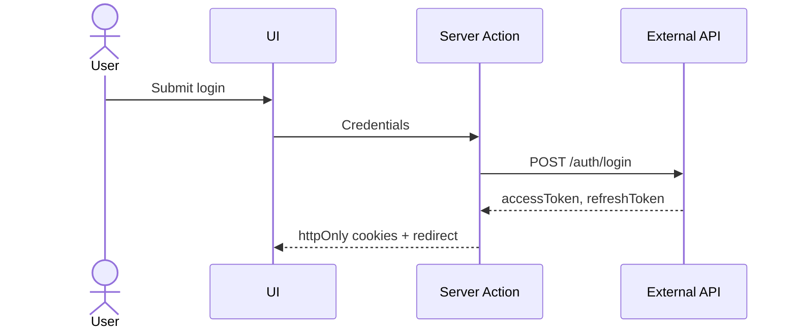
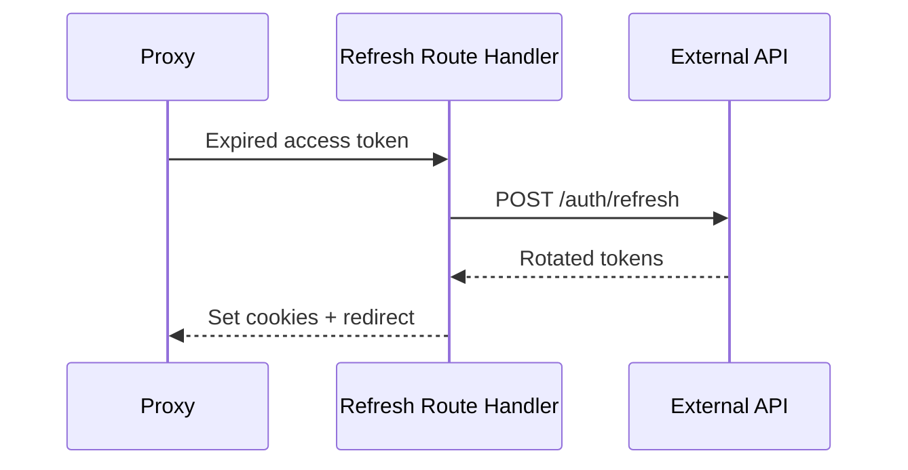

# Next Toolkit

A frontend-only Next.js foundation for applications backed by an external REST API. It includes JWT cookie authentication, server-side API proxying, typed feature boundaries, mock authentication, tests, Docker, and CI. It does not include a database, ORM, migrations, email service, or authentication backend.

## Stack

| Technology                          | Why                                                            |
| ----------------------------------- | -------------------------------------------------------------- |
| Next.js 16 App Router               | RSC, Server Actions, Route Handlers, and route-level rendering |
| React 19 + TypeScript strict        | Typed UI and server composition                                |
| Tailwind CSS 4 + shadcn/ui patterns | Consistent, accessible primitives                              |
| Bun                                 | Fast package management and scripts                            |
| Zod                                 | Runtime validation for env, forms, JWT payloads, and responses |
| React Hook Form                     | Accessible form state and Zod integration                      |
| TanStack Query                      | Hydratable client-side user state                              |
| `jose`                              | JWT verification and JWKS support                              |
| MSW                                 | Browser/node mock backend issuing real signed JWTs             |
| Vitest + Playwright                 | Unit and end-to-end coverage                                   |
| Pino                                | Structured server logging with token redaction                 |

## Prerequisites

- Bun 1.2 or newer
- Docker (optional)
- An external REST API (or the included mock backend)

## Quick start

```bash
bun install
cp .env.example .env
bun run dev:mock
```

Open `http://localhost:3000`. The mock auth backend is available through `/api/mock/*`; use `demo@example.com` and a password of at least eight characters.

To use a real backend:

1. Set `API_BASE_URL` and `NEXT_PUBLIC_APP_URL`.
2. Set `JWT_JWKS_URL`, or set `JWT_SECRET` for HS256 development.
3. Adapt endpoint paths in `src/config/constants.ts`.
4. Generate types with `bun run api:types`.

## Backend contract

All auth endpoints use JSON.

| Endpoint                     | Request                                                   | Success response                                                  |
| ---------------------------- | --------------------------------------------------------- | ----------------------------------------------------------------- |
| `POST /auth/login`           | `{ "email": string, "password": string }`                 | `{ "accessToken": string, "refreshToken": string }`               |
| `POST /auth/register`        | `{ "name": string, "email": string, "password": string }` | `{ "accessToken": string, "refreshToken": string }`               |
| `POST /auth/refresh`         | `{ "refreshToken": string }`                              | `{ "accessToken": string, "refreshToken": string }`               |
| `POST /auth/logout`          | `{}`                                                      | `{ "ok": true }`                                                  |
| `POST /auth/forgot-password` | `{ "email": string }`                                     | `{ "ok": true }`                                                  |
| `POST /auth/reset-password`  | `{ "token": string, "password": string }`                 | `{ "ok": true }`                                                  |
| `POST /auth/verify-email`    | `{ "token": string }`                                     | `{ "ok": true }`                                                  |
| `GET /me`                    | Bearer access token                                       | `{ "id": string, "email": string, "name?": string, "role": "user" | "admin" }` |

Validation errors may use:

```json
{
  "message": "Validation failed",
  "code": "VALIDATION_ERROR",
  "errors": {
    "email": ["Enter a valid email"]
  }
}
```

Access JWTs must include `sub`, `role`, `exp`, and preferably `iss` and `aud`. JWKS is preferred for asymmetric RS256/ES256 verification. HS256 requires the frontend to hold the signing secret, so it is suitable only for controlled development or tightly managed deployments.

## Environment variables

| Name                          | Required       | Description                                 | Example                                          |
| ----------------------------- | -------------- | ------------------------------------------- | ------------------------------------------------ |
| `NODE_ENV`                    | Yes            | Runtime mode                                | `development`                                    |
| `LOG_LEVEL`                   | Yes            | Pino level                                  | `info`                                           |
| `SENTRY_DSN`                  | No             | Optional Sentry DSN                         | empty                                            |
| `API_BASE_URL`                | Yes            | External backend URL                        | `https://api.example.com`                        |
| `NEXT_PUBLIC_APP_URL`         | Yes            | Public frontend origin                      | `https://app.example.com`                        |
| `NEXT_PUBLIC_ENABLE_MOCKS`    | Yes            | Enables mock mode                           | `true`                                           |
| `JWT_JWKS_URL`                | One JWT source | Remote JSON Web Key Set                     | `https://auth.example.com/.well-known/jwks.json` |
| `JWT_SECRET`                  | One JWT source | Shared HS256 secret, at least 32 characters | development-only secret                          |
| `JWT_ISSUER`                  | Recommended    | Required issuer claim                       | `your-api`                                       |
| `JWT_AUDIENCE`                | Recommended    | Required audience claim                     | `your-app`                                       |
| `ACCESS_COOKIE_NAME`          | Yes            | Access cookie name                          | `access_token`                                   |
| `REFRESH_COOKIE_NAME`         | Yes            | Refresh cookie name                         | `refresh_token`                                  |
| `REFRESH_COOKIE_MAX_AGE`      | Yes            | Refresh cookie lifetime in seconds          | `604800`                                         |
| `COOKIE_DOMAIN`               | No             | Optional cookie domain                      | empty                                            |
| `AUTH_REFRESH_LEEWAY_SECONDS` | Yes            | Refresh before access expiry                | `30`                                             |
| `SKIP_ENV_VALIDATION`         | No             | CI/Docker build escape hatch                | `true`                                           |

Build scripts run environment validation normally. `SKIP_ENV_VALIDATION=true` is allowed only for Docker builds and CI where runtime environment variables will be supplied later.

## Folder structure

- `src/app/`: routes and composition only
- `src/features/`: self-contained domain modules; cross-feature imports use `index.ts`
- `src/components/ui/`: shadcn-style primitives
- `src/components/shared/`: shared presentational components
- `src/lib/api/`: single typed fetch client
- `src/lib/session/`: cookie, JWT, and refresh infrastructure
- `src/lib/auth/`: session and authorization helpers
- `src/config/`: validated environment, routes, constants, and site configuration
- `src/providers/`: React providers
- `src/mocks/`: MSW handlers and signed test JWT fixtures
- `src/test/`: test setup and factories
- `e2e/`: Playwright tests
- `docker/`: standalone image and Compose definition

## Architecture rules

1. Route files compose layouts/pages and contain little business logic.
2. Features import other features only through their public `index.ts`.
3. `src/lib/` never imports `src/features/`.
4. Components never call `fetch` directly; use Server Actions or `src/lib/api`.
5. All backend responses are parsed with Zod.
6. Direct `process.env` access is prohibited outside `src/config/env.ts`.
7. Aliases are `@/features/*`, `@/lib/*`, `@/components/*`, and `@/config/*`.

To add a feature:

1. Create `src/features/orders/{components,actions,schemas,api,hooks}/`.
2. Put backend calls in `api/` and use `lib/api`.
3. Export the supported public surface through `src/features/orders/index.ts`.
4. Add route pages under `src/app/(dashboard)/orders/`.
5. Add unit tests beside implementation and E2E scenarios in `e2e/`.

For the full step-by-step workflow, file placement guide, and examples, see the [Developer Guide](docs/DEVELOPER_GUIDE.md).

## Authentication

The access and refresh tokens are stored only in `httpOnly` cookies. Neither reaches browser JavaScript or local storage.

| Cookie  | HttpOnly | Secure     | SameSite | Path        | Lifetime                 |
| ------- | -------- | ---------- | -------- | ----------- | ------------------------ |
| Access  | Always   | Production | Lax      | `/`         | Matches JWT `exp`        |
| Refresh | Always   | Production | Strict   | `/api/auth` | `REFRESH_COOKIE_MAX_AGE` |

### Login



### Silent refresh

The proxy detects missing or near-expiry access tokens and redirects to `/api/auth/refresh?next=<path>`. The Route Handler sends the refresh cookie to the backend, writes rotated cookies, and redirects back. Refreshes share an in-flight promise by refresh token. Refresh failure clears both cookies and sends the user to login.



Guarding a page:

```tsx
import { requireUser } from "@/lib/auth/session";

export default async function ProtectedPage() {
  const user = await requireUser();
  return <h1>{user.id}</h1>;
}
```

Use `requireRole(["admin"])` for role-specific server behavior and `<RoleGate role={user.role} allowed={["admin"]}>` for UI. `can(user, "manage:users")` provides typed permission checks.

## API client and proxy

The server-side client reads the access cookie and adds `Authorization: Bearer <token>`. Client components must use Server Actions or call `/api/proxy/[...path]`. The proxy validates same-origin requests and forwards them to `API_BASE_URL`.

Set `NEXT_PUBLIC_ENABLE_MOCKS=true` for mock mode. MSW handlers issue HS256 test JWTs and mock all auth and `/me` endpoints. The browser mock is available at `src/mocks/browser.ts`; Vitest uses `src/mocks/server.ts`.

## Testing

```bash
bun run test
bun run test:watch
bun run test:e2e
bun run lint
bun run typecheck
bun run build
```

Unit tests live beside source files. Playwright starts the app against the mock backend and covers register, login, redirects, and logout flows.

## Scripts

| Script                      | Purpose                      |
| --------------------------- | ---------------------------- |
| `dev`                       | Start Next.js                |
| `dev:mock`                  | Start with mock mode enabled |
| `build`                     | Production build             |
| `start`                     | Start standalone build       |
| `lint` / `lint:fix`         | ESLint                       |
| `format`                    | Prettier                     |
| `typecheck`                 | Strict TypeScript            |
| `test` / `test:watch`       | Vitest                       |
| `test:e2e`                  | Playwright                   |
| `api:types`                 | Generate OpenAPI types       |
| `env:check`                 | Validate environment         |
| `docker:up` / `docker:down` | Compose lifecycle            |
| `prepare`                   | Install Husky                |

## Docker

```bash
bun run docker:up
bun run docker:down
```

The image uses a multi-stage Bun build, standalone Next.js output, and a non-root runtime user.

## CI/CD

GitHub Actions runs Bun install, lint, typecheck, unit tests, build, Playwright, dependency audit, and CodeQL.

## Deployment

### Vercel

Configure every runtime environment variable. Set `JWT_JWKS_URL` or `JWT_SECRET`, `API_BASE_URL`, and `NEXT_PUBLIC_APP_URL`. Keep `NEXT_PUBLIC_ENABLE_MOCKS=false`.

### Docker/VPS

Build and supply runtime variables. Terminate TLS at the reverse proxy. Ensure the app origin matches `NEXT_PUBLIC_APP_URL` and that cookies are issued over HTTPS.

## Security

- Refresh token rotation and reuse detection belong in the backend.
- Revoke refresh sessions on logout.
- Keep `JWT_JWKS_URL` preferred over a shared signing secret.
- The backend remains authoritative for every authorization decision.
- httpOnly cookies prevent JavaScript token theft but do not prevent actions from a compromised in-page script.
- Strict CSP and security headers are configured; avoid `dangerouslySetInnerHTML`.
- SameSite cookies help CSRF; Server Actions provide origin checks and the proxy validates Origin/Host.
- Keep cookies on the frontend origin to avoid cross-site cookie constraints.
- No application rate limiting is implemented; enforce it on the backend.
- CORS is the backend concern and should allow only the frontend origin.

## Troubleshooting

- **Build says env is missing:** copy `.env.example` to `.env` and fill required values.
- **Docker build says env is missing:** set `SKIP_ENV_VALIDATION=true` for build time and supply runtime env in Compose/deployment.
- **Refresh redirects to login:** confirm refresh cookie Path is `/api/auth`, the refresh endpoint accepts the backend contract, and JWT issuer/audience match.
- **Login does not redirect:** ensure `next` is a single-leading-slash relative path and no `//`, backslash, or absolute URL is present.
- **MSW is inactive:** set `NEXT_PUBLIC_ENABLE_MOCKS=true` and use `bun run dev:mock`.

## Contributing

Use conventional commits:

```text
feat(auth): add password reset
fix(api): preserve abort signal
docs(readme): clarify deployment
```

Before submitting: run lint, typecheck, unit tests, build, and relevant E2E tests.
